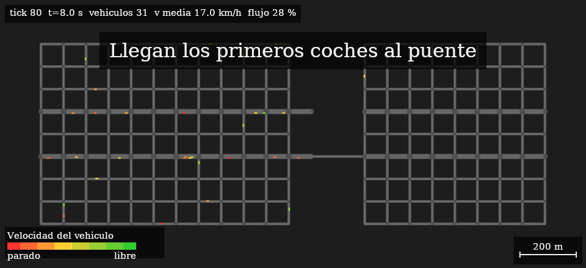

# Devlog 2026-10-30: cierre de M1 (tráfico)

Resumen visual: `docs/media/m1-demo.png` (antes/después y curva de flujo %). Reproducible con
`Sim.Runner --scenario bottleneck --gif out.gif --render out.png`.

**Qué hace ya la simulación de tráfico.** Red de carreteras con cruces (prioridad y semáforos), vehículos con conducción por
carril y cambio de carril, pathfinding con landmarks y congestión, generador de viajes con puntos de demanda ponderados,
detección y resolución de bloqueo total, métricas de flujo, edición de la red en caliente (comandos con deshacer) y tests golden
deterministas. Visor PNG/GIF propio en `Sim.Runner`.

**La demo.** Un barrio y una zona de empleo unidos por un único puente. Con demanda de izquierda a derecha el puente satura
(~0,4 coches/s) y la cola se extiende por el barrio. A los 120 s se abre una avenida 2+2 con un `BuildRoadCommand`; los coches parados
piden ruta nueva y la usan. Flujo %: ~30 % al abrir (mínimo 18 %), 83 % al final; la misma simulación sin avenida se queda en 12 %.
Pico de ~410 vehículos activos (no 2.000: el cruce limita la capacidad, ver tarjeta M1-14).

**Rendimiento** (`docs/perf/2026-10-30-m1.md`, x64 de servidor, un hilo): 3.000 vehículos ~1 ms/tick, 6.000 ~2,3 ms,
16.000 ~7 ms (p95 13,5 ms); 0 B/tick en régimen estable. Presupuesto móvil medio (8 ms) con ~8x de margen antes de peatones.

**Siguiente: M2.** Peatones y ciudadanos con vida propia, zonificación y edificios que crecen, y llevar `Sim.Core` a Unity.
